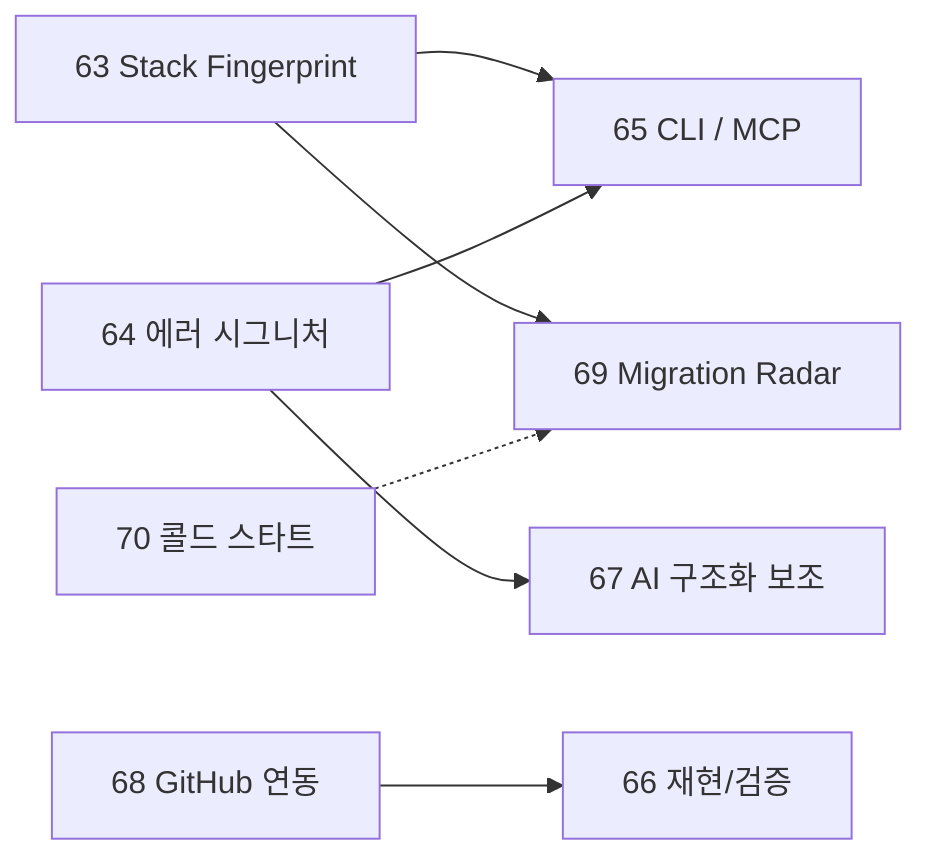
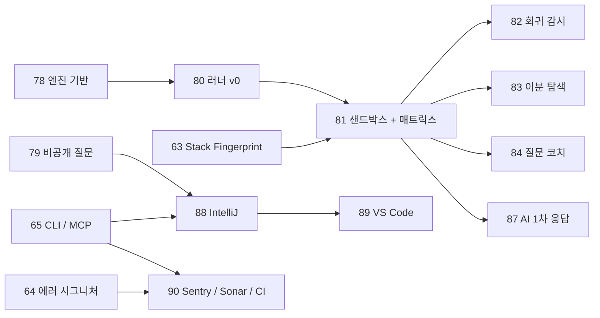

# 경쟁 분석과 차별화 로드맵

> 제품 철학은 [vision.md](vision.md), MVP 범위는 [mvp-scope.md](mvp-scope.md), 실행 단위는 [PLAN.md](../../PLAN.md)의 Phase 63~99 참고. 이 문서는 "Quno가 다른 질문 플랫폼과 무엇이 다르고, 아직 무엇이 비어 있으며, 그래서 다음에 무엇을 만들 것인가"를 한곳에 모은다.
>
> **작성 기준**: 2026-10. 경쟁 서비스에 대한 서술은 작성 시점의 일반 지식이며 별도 조사로 검증한 수치가 아니다. 외부에 인용하기 전에는 최신 자료로 확인한다.

## 1. 비교

| | Stack Overflow | 범용 Q&A (Quora·지식iN·아하) | Quno |
|---|---|---|---|
| 지식의 시간 처리 | 수동. 오래된 채택 답변이 그대로 남음 | 거의 없음 | 새 릴리스 감지 → 재검토 알림(Outdated) |
| 질문 수정 | 편집 이력은 있으나 답변이 어느 판본에 달렸는지 연결 안 됨 | 약함 | 리비전 + diff, 답변이 특정 판본을 지목 |
| 중복 | Close(사실상 폐기) | 거의 방치 | Cluster → Super Answer로 승격 |
| 변화 추적 | 팔로우 | 팔로우/알림 | Ward(질문의 변화 구독) |
| 신뢰 | 투표·평판 | 채택·등급·전문가 인증(아하는 보상 중심) | 투표·평판 + 이메일 도메인 인증 조직 |

범용 서비스 세 곳은 구조가 같아 묶었다. 질문은 일회성 게시물이고 개발 맥락(버전·에러·환경)이 없다. 한국어 개발자 Q&A는 OKKY 정도가 사실상 유일한 직접 경쟁이라 이 자리가 비어 있다.

## 2. 실제로 강한 점

- **데이터 모델이 다르다.** 리비전, 답변-판본 연결, Cluster/Fork, Ward는 기능이 아니라 모델 수준의 차이라 경쟁사가 따라 하기 어렵다.
- **중복 처리 방식이 다르다.** SO에서 신규 사용자가 가장 불만을 갖는 "중복으로 닫힘"을 "문제가 중요하다는 신호"로 바꿨다.
- **문서에서 끝나지 않고 구현돼 있다.** 조직 인증, 유료 Direct Ask, 실시간 질문방, Spike Detection, 질문의 생애 타임라인이 동작하고, 장애 시나리오 21개를 검증했다([failure-scenario-testing.md](../operations/failure-scenario-testing.md)).

## 3. 솔직한 약점

1. **가장 큰 경쟁자는 Stack Overflow가 아니라 AI 어시스턴트다.** "답 얻기"는 이미 AI가 대체했다. [제품 원칙 4](vision.md#제품-원칙-기능-우선순위-판단-기준)는 AI를 구조화 보조로만 두는데, 현재 코드에는 AI 기능이 없고 검색은 PostgreSQL 전문검색 + 태그뿐이다(의미 검색 없음). 이 위협에 대한 근본 답은 7절이다.
2. **핵심 차별점이 가장 얇게 구현돼 있다.** vision.md는 "기술 버전을 구조화된 메타데이터로 관리"한다고 쓰지만, 실제 `environment`는 자유 텍스트다. 버전 영향 감지도 태그 slug → 제품 수동 매핑과 "콘텐츠가 릴리스보다 오래됨"이라는 휴리스틱이라 어느 버전에서 유효한 답인지 모른다. 오탐 우려로 자동 OUTDATED 전환도 하지 못한다([ADR-0033](../architecture/decisions/0033-technology-version-scan-detection-only-no-auto-outdated.md)).
3. **콜드 스타트.** 해자가 "질문 그래프의 밀도"인데 초기에는 그래프가 없다.
4. **개발 흐름 밖에 있다.** 개발자는 IDE·터미널·GitHub에서 막힌다. 웹사이트에 와서 질문을 쓰는 것 자체가 마찰이다.
5. **답변 검증이 투표뿐이다.** "이 답이 실제로 동작하는가"를 확인할 수단이 없다.

## 4. 차별화 로드맵

| Phase | 제안 | 해결하는 약점 | 선행 |
|---|---|---|---|
| 63 | **Stack Fingerprint + 적용 버전 범위** (키스톤) | 2 | 없음 |
| 64 | 에러 우선 질문 작성 (에러 시그니처) | 1, 4 | 없음 (63과 병행 가능) |
| 65 | CLI + MCP 서버 | 4, 1 | 64(읽기 전용 MCP), 63(스택 자동 첨부) |
| 66 | 재현 가능한 질문 + 검증된 답변 | 5 | 단계 2는 68 |
| 67 | AI 구조화 보조 (의미 검색·초안 정리·요약) | 1 | 없음 (64 이후가 효과적) |
| 68 | GitHub 연동 | 4, 5 | 없음 |
| 69 | Migration Radar | 2, 3 | 63 + 데이터 누적 |
| 70 | 콜드 스타트 시딩 | 3 | 없음 (사람이 할 일 포함) |



### 4.1 Stack Fingerprint + 적용 버전 범위 (Phase 63)

`build.gradle.kts`·`pom.xml`·`package.json`(+lockfile) 등을 붙여넣으면 (생태계, 패키지, 버전)으로 파싱해 구조화 저장하고, 답변에는 "spring-boot ≥3.2 <4에서 유효" 같은 **적용 범위**를 둔다. Outdated 판정이 휴리스틱에서 "새 릴리스가 답변의 적용 범위를 벗어났는가"로 바뀌어, 영향받는 답변만 골라 재검토를 요청할 수 있다. 내 프로젝트 의존성 기준으로 Ward를 자동 제안하면 "지식을 위한 Dependabot"이 된다. 로드맵의 다른 항목 상당수가 이 데이터에 기대므로 가장 먼저 한다.

- 자동 OUTDATED 전환은 여전히 하지 않는다. 정밀해진 신호를 사람에게 보여줄 뿐이다(ADR-0033의 결정 유지).
- 의존성 파일에는 사내 패키지명·저장소 URL이 섞일 수 있다. 원본 파일은 저장하지 않고 파싱 결과만 저장하며, 저장 전 미리보기에서 항목을 제외할 수 있게 한다.

### 4.2 에러 우선 질문 작성 (Phase 64)

스택트레이스를 붙이면 경로·메모리 주소·스레드명·프록시 접미사를 제거해 에러 시그니처로 정규화한다. 질문을 쓰기 전에 "같은 에러 N건, Super Answer 있음"을 보여주고, 검색창에 스택트레이스를 붙여 넣어도 같은 시그니처로 찾는다. vision.md의 `RedisCommandTimeoutException` 검색 비전의 첫 단계다.

### 4.3 CLI + MCP 서버 (Phase 65)

`./gradlew test 2>&1 | quno ask`처럼 로그를 파이프로 넘기고 스택 지문을 자동 첨부한다. MCP 서버는 코딩 에이전트가 Quno의 Super Answer와 OUTDATED 표시를 조회하게 한다. AI를 경쟁자가 아니라 **유통 채널**로 쓰는 방향이다. 읽기 전용부터 열고, 질문 등록 같은 쓰기는 사용자 승인을 거친다. 이를 위해 현재 JWT 로그인만 있는 인증에 개인 액세스 토큰(PAT)이 필요하다.

### 4.4 재현 가능한 질문 + 검증된 답변 (Phase 66)

1단계는 재현 정보(Dockerfile·devcontainer·저장소 링크)를 구조화 필드로 받고, 다른 사용자가 자기 환경 스냅샷과 함께 "재현됨/안 됨"을 표시한다. 2단계는 답변에 테스트를 포함해 **외부 CI 결과**를 받아 "검증됨" 배지를 준다. 서버가 직접 실행하는 격리 러너는 [ADR-0068](../architecture/decisions/0068-living-engine-runner-and-ai-first-responder.md)이 허용했고 Phase 80~81에서 단계적으로 도입한다(6절).

### 4.5 AI 구조화 보조 (Phase 67)

범위는 (a) 로그에서 환경·에러 추출과 누락 정보 선제 요청, (b) FTS + 벡터 하이브리드 검색으로 한/영 중복 후보 탐색, (c) 클러스터 요약 → Super Answer 초안이다. 이 Phase의 초안은 사람이 승인해야 게시된다. AI가 질문에 직접 응답하는 것은 Phase 87에서 [ADR-0068](../architecture/decisions/0068-living-engine-runner-and-ai-first-responder.md)의 조건 아래 따로 다룬다. 사용자 데이터를 외부 모델에 보내는 정책(옵트인·마스킹·비용 상한)을 먼저 정한다.

### 4.6 GitHub 연동 (Phase 68)

질문과 이슈/PR을 양방향으로 연결하고, 이슈가 닫히거나 수정이 릴리스에 포함되면 상태 전환을 *제안*한다(자동 전환 아님). 저장소 쓰기 권한을 확인해 "maintainer verified" 배지를 준다. 권한은 읽기 전용 최소 범위로 시작한다.

### 4.7 Migration Radar (Phase 69)

현재 스택과 목표 버전을 입력하면 "이 업그레이드 구간에서 커뮤니티가 겪은 질문 Top N"을 보여준다. 질문의 영향 버전과 해결 버전 구간을 집계하므로 63의 데이터가 쌓여야 의미가 있고, 데이터가 임계치 미만이면 노출하지 않는다.

### 4.8 콜드 스타트 (Phase 70)

좁게 시작한다. 태그 구성이 이미 Kotlin/Spring/Redis/PostgreSQL에 몰려 있으니 한국어 백엔드 개발자를 첫 대상으로 하고, 공식 이슈 트래커·릴리스 노트의 known issues를 카드로 시딩한다. 가져오기 도구와 출처 표기 필드는 코드로, 대상 선정·메인테이너 초대·라이선스 확인은 사람이 할 일이다.

## 5. 사용자가 직접 체감하는 기능 (Phase 71~77)

4절이 기반(데이터·연동)이라면 이쪽은 화면에서 바로 느껴지는 기능이다. 기준은 "처음 들어온 사용자가 10초 안에 느끼고, AI 채팅이 구조적으로 못 하는 것"이다. AI는 "3일 전 3.4에서 7명이 확인했다" 같은 **집단의 시간·환경 기반 증거**를 말할 수 없다. "질문의 생애" 타임라인([ADR-0062](../architecture/decisions/0062-question-activity-signals-and-timeline.md))은 이미 구현돼 있어 후보에서 제외했다.

| Phase | 기능 | 선행 | 비고 |
|---|---|---|---|
| 71 | 실시간 질문방 → 답변으로 게시 | 없음 | 가장 싸고 바로 체감. 먼저 착수 권장 |
| 72 | 영향 매트릭스 + "아직 돼요 / 이제 안 돼요" | 63 | AI와 가장 확실히 갈리는 지점 |
| 73 | 내 스택 렌즈 | 63 (72와 함께) | |
| 74 | 패치로 답하기 | 없음 | 리비전용 `DiffView` 재사용 |
| 75 | 로그·코드 줄 단위 코멘트 + 질문 수정 제안 | 없음 | 기존 QPR(ReviewRequest)과 연결 |
| 76 | 트러블슈팅 위저드 | 64 + Cluster 데이터 | 데이터가 얕으면 비노출 |
| 77 | 내 스택 주간 다이제스트 + 메인테이너 허브/README 배지 | 63, 68 | 재방문·확산 |

### 5.1 질문방 → 답변으로 게시 (Phase 71)

지금은 질문방이 해결되면 대화가 휘발된다. 해결 순간 메시지를 골라 답변 초안으로 편집·게시하고, 답변에 "질문방 대화에서 정리됨" 출처를 남긴다. AI 없이 선택 UI만으로 되며, 채택 권한은 질문 작성자에게 그대로 둔다.

### 5.2 영향 매트릭스 + "아직 돼요 / 이제 안 돼요" (Phase 72)

질문 상단에 `Spring Boot 3.2 (12명) · 3.3 (8명) · 3.4 (재현 안 됨)`처럼 환경별 현황이 보이고, 오래된 채택 답변 옆에 "3일 전 3.4에서 7명 확인"이 붙는다. "+1" 댓글이 구조화된 데이터가 된다. 기존 "같은 문제 표시"(질문 간 연결)와는 단위가 다르다 — 이쪽은 한 질문/답변에 대한 환경별 사용자 확인이다. 참여자가 없으면 빈 막대가 되므로 임계치 미만이면 숨기고, 내 스택 프로필이 있으면 환경을 자동 첨부해 원클릭으로 참여하게 한다. 쌓인 "이제 안 돼요"는 63의 영향 감지에 신호로 들어간다.

### 5.3 내 스택 렌즈 (Phase 73)

"내 환경으로 보기" 스위치를 켜면 답변마다 ✅ 내 환경에서 유효 / ⚠️ 다른 버전 대상 / ⛔ 내 버전 기준 낡음이 붙고, 답변이 환경 탭으로 묶인다. 적용 범위가 없는 답변은 "유효"가 아니라 "판정 불가"로 표시한다.

### 5.4 패치로 답하기 (Phase 74)

질문의 코드/설정 위에서 답변자가 수정하면 diff로 보이고 `git apply`용으로 복사된다. 패치가 질문의 코드에 깨끗이 적용되는지는 서버가 텍스트 수준에서만 검사한다(실행 아님). IDE 연동에서 "패치 적용"으로 이어진다.

### 5.5 줄 단위 코멘트 + 질문 수정 제안 (Phase 75)

질문의 로그·코드 줄에 코멘트를 달고, GitHub의 suggested change처럼 질문 수정을 제안한다. 새 개념을 늘리지 않도록 기존 QPR 흐름에 연결한다. 질문이 리비전되면 앵커가 어긋나므로 이동·만료 규칙이 설계의 핵심이다.

### 5.6 트러블슈팅 위저드 (Phase 76)

에러를 검색하면 목록 대신 "Docker 안에서 실행 중인가? 기동 시인가 런타임인가?" 같은 2~3개 질문으로 내 Super Answer까지 안내한다. Cluster의 분기를 질문 카드로 표현해야 하므로 데이터가 충분히 쌓인 Cluster에만 노출한다.

### 5.7 주간 다이제스트와 메인테이너 허브 (Phase 77)

내 스택에서 새로 생긴 질문과 Ward 중 낡은 답변을 주간으로 알려 재방문을 만든다. 라이브러리 메인테이너에게는 고정 FAQ와 열린 이슈 요약이 있는 태그 홈과 README용 `known issues: N` 배지를 제공해 확산 경로로 쓴다.

## 6. 백엔드 엔진과 IDE 연동 (Phase 78~90)

결정은 [ADR-0068](../architecture/decisions/0068-living-engine-runner-and-ai-first-responder.md)이 정한다. 배경은 사용자가 제시한 구상이다 — 백엔드에서 엔진이 끊임없이 돌며 질문·답변을 훼손 없이 다듬고, 코드가 있으면 버전별로 실제로 실행해 재현 여부와 **마지막 재현 시각**을 기록하고, IDE에서 에러와 문제 코드를 곧바로 올려 AI와 사람이 한 스레드에서 답한다.

### 6.1 원칙

- **엔진은 원본을 수정하지 않고 제안(PR)만 연다.** 질문 판본은 append-only이고 QPR(ReviewRequest)·Fork가 있다. 엔진은 QunoBot 주체로 별도 레이어(주석·제안·실행 기록)에만 쓰고, 작성자가 수락하면 그때 새 리비전이 된다.
- **모든 산출물에 증거를 붙인다.** 출처, 입력 해시, 환경 이미지 다이제스트, 실행 로그 참조. 이의가 제기되면 재실행한다.
- **상태 전환은 사람이 한다.** 엔진은 "깨짐 감지" 같은 증거 배지를 자동으로 붙이지만 OUTDATED 전환은 사람의 승인으로만 일어난다([ADR-0033](../architecture/decisions/0033-technology-version-scan-detection-only-no-auto-outdated.md)).
- 한 줄로 **"AI가 제안하고, 실행이 증명하고, 사람이 판단한다."**
- 토대는 이미 있다: Outbox와 스케줄러(Outbox 디스패치 2초, 버전 스캔 일 1회, 메트릭), append-only 판본, QPR, Fork.

### 6.2 엔진이 하는 일

| Phase | 기능 | 선행 |
|---|---|---|
| 78 | **엔진 기반 레이어**(제안·출처·QunoBot) + 비밀정보 탐지·정리 제안 — 실행이 필요 없어 첫 엔진 기능 | 없음 |
| 79 | **비공개 질문**(조직 범위) + 정제 후 공개 — IDE 연동의 선행 조건 | 없음 |
| 80 | 재현 러너 v0(외부 CI 기반) + **마지막 재현 시각** 기록·표시 | 66.1, 68, 78 |
| 81 | 호스티드 샌드박스 러너 + 버전 매트릭스 | 63, 80 |
| 82 | **신규 릴리스 자동 회귀 감시** — 새 버전이 나오면 검증된 답변을 다시 돌려 깨진 것만 "깨짐 감지" | 81 |
| 83 | **버전 자동 이분 탐색** — "3.2.0에서 처음 발생, 3.3.4에서 수정"을 실행으로 찾아 적용 범위·영향 매트릭스를 제안 | 63, 81 |
| 84 | **질문 코치** — 제출 전 백그라운드 재현 시도, "재현되지 않음, 환경 정보 부족" 피드백, 더 작은 재현 코드 제안 | 64, 81 |
| 85 | 방치 질문 부활(수정 릴리스 감지 시 "올리면 해결되나요?"), 취약점·deprecation 경고 | 68, 63, 81 |
| 86 | 지식 엮기 — 모순되는 답변을 실행 결과로 가리고 Cluster 병합을 제안 | 67, 81 |
| 87 | **AI 1차 응답 + 검증된 제안 루프** | 67, 78, 81 |
| 88 | IntelliJ 플러그인 | 65, 63, 64, 79, 74 |
| 89 | VS Code 확장 | 88 |
| 90 | Sentry·SonarQube·CI 연동 | 64, 65 |



재현 기록은 한 줄로 보인다: `재현됨 · Kotlin 2.2.21 / JDK 21 · 2시간 전 (실행 로그 보기)`. 결과는 `재현됨 / 재현 안 됨 / 빌드 실패 / 판단 불가` 4종이고, **재현됨이 정답은 아니다**(재현 코드가 문제를 잘못 모사하거나 flaky일 수 있다). 그래서 원시 로그를 항상 열람할 수 있게 하고 이의를 받는다.

### 6.3 AI의 자리

AI는 답변 작성자가 아니라 라벨이 붙은 **1차 응답자**다. IDE에서 올린 직후 몇 초 안에 알려진 이슈 매칭, 가설, 누락 정보 요청을 달고, 수정 패치를 제안하면 러너가 재현 코드에 적용해 테스트를 돌린다. 통과하면 "검증된 AI 제안"이 된다. AI의 약점인 환각을 실행으로 걸러내는 구조다.

- AI 출력은 `Answer`가 아닌 별도 객체이고 화면에서 구분된다.
- 검증 통과나 사람 확인 전에는 평판·채택·Super Answer에서 제외한다.
- 사람이 수락해 리비전이나 `Answer`로 올리면 그 사람 명의가 된다.
- 외부 모델 전송은 옵트인·마스킹·비용 상한을 지키고, 사용자·조직 단위로 끌 수 있다.

### 6.4 실행 인프라와 격리

1. **1단계**: 사용자 저장소 + GitHub Actions 결과를 받는다(Quno는 실행하지 않음).
2. **2단계**: 호스티드 샌드박스 제공자를 JVM Gradle·Node에만 쓴다.
3. **3단계**: 자체 호스팅은 2단계의 비용·제약이 임계를 넘을 때만 검토한다.

공통 요건은 네트워크 차단(패키지 미러 허용목록만), 시간·메모리·CPU 상한, 일회성 환경, 비밀값 없음, 사용자 쿼터와 신뢰 등급, 같은 코드+환경 해시의 결과 재사용, 이벤트(새 릴리스) 기준 재검증, 조회수 높은 순 우선이다. 첫 슬라이스는 "단일 파일 Kotlin 스크립트 + 최소 Gradle 프로젝트, 버전 3~5개"로 좁힌다.

### 6.5 IDE 흐름

1. 콘솔의 스택트레이스, 실패한 테스트, 컴파일 오류, Sonar 이슈를 우클릭해 **"Quno에 질문"**을 고른다.
2. 플러그인이 정규화된 에러 시그니처, 선택 코드와 주변, 의존성 지문, JDK·OS, 실패 테스트를 첨부한다. **업로드 전에 로컬에서 비밀값을 스캔**하고 미리보기를 보여준다.
3. 에러가 이미 알려져 있으면 올리기 전에 알린다: `Quno: 이 에러 14건 · ✅ 3.3.1에서 재현·해결 확인 2시간 전`.
4. 올리면 AI 1차 응답, 백그라운드 재현, 사람 답변이 한 스레드에 모이고 IDE의 "Quno Inbox"로 알림이 온다.
5. 해결책이 패치면 IDE에서 diff를 보고 적용한다(Phase 74).

IntelliJ를 먼저 만든다(첫 대상이 Kotlin/Spring 개발자이고 팀 스택과 같다). 클라이언트는 얇게 두고 CLI/MCP(Phase 65)의 토큰·API를 공유한다.

### 6.6 연동 지점

세부 API는 착수 시 각 서비스 문서로 확인한다.

- **Sentry**: 이슈에서 Quno 질문 만들기, 이슈 스택트레이스가 알려진 시그니처면 링크 표시, 질문 쪽에 연결된 이벤트 수 표시.
- **SonarQube**: 규칙 키(`kotlin:S1135` 등)를 에러 시그니처와 같은 방식으로 색인해 "이 규칙 위반을 어떻게 고치나"에 이전 Q&A를 붙인다.
- **CI**: 테스트 실패 시 로그를 담은 질문 초안을 만드는 GitHub Action.

### 6.7 선행 조건과 위험

- **비공개 질문(Phase 79)이 먼저다.** 지금 질문에는 공개 범위 개념이 없다. 비공개는 외부 모델 전송과 러너 실행 모두 기본 금지이고, 검색·피드·Flow·대시보드·관련 질문·Cluster·sitemap·OG와 전역 캐시에 섞이지 않는지 전수 점검이 핵심이다.
- **비용과 보안**이 상시 부담이다. 계측하고 상한을 둔다.
- **법적·약관 검토**(사용자 코드를 실행·보관하는 것)는 러너 도입 전에 사람이 확인한다.
- **Quno가 CI 회사가 되지 않게** 허용 생태계 한정, 단계적 도입으로 막는다.

## 7. AI 에이전트 시대의 재정의 (Phase 91~99)

결정은 [ADR-0069](../architecture/decisions/0069-agent-era-positioning-verified-fix-memory.md)(포지셔닝)와 [ADR-0070](../architecture/decisions/0070-question-as-evidence-environment-snapshot-and-verification-tiers.md)(질문은 증거 자료)이 정한다. 출발점은 근본 질문이다 — AI가 구현하고 에러를 해결하는 시대에 굳이 Q&A 플랫폼을 쓸 이유가 있는가. **이 절은 가설이며** Phase 91의 실험으로 검증한다.

### 7.1 전제와 결론

에러 수정 같은 대부분의 수요는 에이전트가 직접 해결하므로 사람이 사이트에 와서 질문을 쓰는 사용은 대부분 사라진다. 남는 수요는 에이전트가 구조적으로 주지 못하는 것이다.

| 수요 | AI가 못 주는 이유 | Quno가 줄 것 | 쓰는 쪽 |
|---|---|---|---|
| 최신성 ("3.4.1 나온 지 이틀, 뭐가 깨졌나") | 학습·검색 시점보다 늦고, 이를 구조화해 내놓는 곳이 없음 | 릴리스 직후 환경별 깨짐 보고 | 에이전트(업그레이드 전 조회) |
| 검증 ("이 수정이 맞나") | AI는 그럴듯하게 틀린다. 병목은 생성이 아니라 확인 | 실행 증거·재현 시각·확인 수가 붙은 해결 | 에이전트가 인용, 개발자 |
| 막힌 롱테일 | 에이전트가 여러 번 시도해도 못 푸는 건 결국 사람 몫인데 넘길 통로가 나쁨 | 시도 내역이 담긴 구조화된 에스컬레이션 | 전문가, 메인테이너 |
| 경험 기반 판단 | AI는 일반론. 경험은 규모·날짜·귀속이 있어야 가치 | 환경·규모 맥락이 붙은 경험 보고 | 아키텍처를 정하는 개발자 |
| 팀의 기억 | 팀원마다 에이전트가 같은 문제를 처음부터 다시 풂 | 자동 캡처되는 사내 해결 기록 | 팀, 신규 입사자 |
| 메인테이너 트리아지 | AI가 만든 저품질 이슈 홍수 | 재현·중복 제거된 사전 트리아지, 실패 시그니처 집계 | 메인테이너, 벤더 |

결론: Quno는 Q&A 사이트가 아니라 **증거가 붙은 해결 기록소 + AI→사람 에스컬레이션 통로**다. 주 소비자는 에이전트이고 주 콘텐츠는 질문 글이 아니라 **해결 기록(Resolved Record)과 깨짐 보고**다.

### 7.2 새 흐름

1. 개발자가 에이전트에게 에러 수정이나 업그레이드를 시킨다.
2. 에이전트가 Quno MCP를 먼저 조회한다(에러 시그니처 + 환경 지문). 히트하면 검증된 해결과 경고("3.4.0에서 이 방식은 깨짐, 14명 확인")를 받아 적용하고 인용한다.
3. 미스면 에이전트가 직접 푼다. 성공하면 **동의를 받아** 해결 기록을 제출한다(환경 스냅샷 + 수정 패치 + 재현). 로컬 정제 후 러너가 검증하면 그래프에 들어간다. 글을 쓰는 사람이 없다.
4. N번 시도해도 막히면 "무엇을 해봤고 어떻게 실패했나"를 담아 에스컬레이션한다. 전문가·메인테이너 또는 유료 Direct Ask로 간다.
5. 사람의 해답은 러너로 검증된 뒤 이후 모든 에이전트에게 전달된다.
6. 이후 에이전트들이 "아직 돼요/깨졌어요"를 환경 스냅샷과 함께 자동 보고해 최신성이 유지된다.

콜드 스타트도 바뀐다. 사람의 글쓰기가 아니라 에이전트 세션이 공급하므로, 커버리지 밀도를 좁은 스택(Kotlin/Spring)에서 먼저 만든다.

### 7.3 환경 스냅샷 — 그 순간의 컴퓨터 상태를 캡처한다

에이전트가 질문·해결 기록을 올릴 때 APM 에이전트가 메트릭을 수집하듯 구체적인 환경 정보를 자동으로 첨부한다. 사람은 가장 중요한 단서(인코딩, 컨테이너 여부, 해석된 의존성, 마지막으로 잘 되던 때와의 차이)를 빠뜨리기 때문이다.

**원칙**

- **상시 모니터링이 아니라 이벤트 기반 캡처다.** 제출·에스컬레이션·실패 시점에만 수집한다. 에이전트는 최근 명령·출력의 **링 버퍼를 로컬 메모리에만** 두었다가 실패 때 동결해 첨부한다(블랙박스 기록기).
- **수집·정제·미리보기·동의는 모두 로컬에서 끝낸다.** 서버에 닿기 전에 비밀값 스캔(패턴 + 엔트로피), 경로·사용자명·호스트·IP 정규화, 필드별 포함/제외 미리보기를 거친다. 건별 동의이고 철회할 수 있다.
- **증상 기반 수집 프로파일.** 모든 걸 모으지 않고 에러 종류에 맞는 항목만 더한다(OOM → 힙·cgroup, DB 타임아웃 → 커넥션 풀·DB 버전, 의존성 해석 실패 → 레지스트리·프록시 설정). 최소 수집이고 질문이 잡음에 묻히는 것도 막는다.
- **기준선 대비 델타가 가장 값어치 있다.** "마지막으로 잘 되던 때 이후 무엇이 바뀌었나"(의존성 변경, 커밋 요약, 설정 변경)를 함께 첨부하고 환경 차이를 diff로 보여준다.
- **환경 지문(콘텐츠 주소 해시)**으로 같은 환경끼리 묶는다. 영향 매트릭스(72), 깨짐 레이더(69), 러너의 환경 이미지 레시피(81)가 이 해시를 쓴다.
- **수집기 서명.** 공식 수집기가 만든 스냅샷은 서명되고, 수동 입력은 낮은 신뢰로 표시한다.

**민감도 3계층**

| 계층 | 내용 | 공개 질문 기본 |
|---|---|---|
| Tier 0 | OS·아키텍처·커널, 런타임(JDK 벤더+버전 등), 컨테이너/가상화(Docker·WSL·Rosetta), 로케일·인코딩·타임존, 도구 버전, IDE, **해석된 의존성**, 정제된 JVM 인자, CI 여부, git 커밋 SHA·dirty 여부 | 포함 |
| Tier 1 | 실패 직전 로그 창, 실행한 명령과 종료 코드, 허용목록 환경변수, 설정 파일의 키(값은 정제), 실패한 테스트 출력 | 포함 |
| Tier 2 | 메모리·디스크·cgroup 한도, 의존 서비스 버전, 스레드 덤프, OOM 이벤트, 열린 연결 수 | 옵트인 |
| 수집 금지 | 자격 증명·토큰·개인 키, 허용목록 밖 환경변수 값, 선택하지 않은 소스 내용, 브라우저 기록, 사용자·호스트 식별자 | 없음 |

비공개(조직) 질문은 조직 정책이 허용 범위를 정한다. 위험은 단연 과수집과 정제 누수이므로 알려진 비밀 패턴 코퍼스로 누수를 테스트하고 목표를 0건으로 둔다.

### 7.4 검증된 질문 — 질문이 AI의 근거 자료가 된다

질문을 쓰고 끝내지 않고 절차와 조건을 통과시켜 등급을 매긴다. 검증된 질문은 "이 환경에서 이 실패가 실제로 발생한다"는 증거 자료다.

| 등급 | 이름 | 조건 |
|---|---|---|
| L0 | 미검증 | 자유 텍스트 초안 |
| L1 | 구조 충족 | 필수 항목(에러 시그니처, 환경 스냅샷, 기대/실제 동작, 재현 절차)이 있고 비밀 스캔·린트·중복 검사를 통과 |
| L2 | 재현됨 | 최소 재현을 러너가 선언한 환경에서 실행해 실패를 재현했고, **재현된 에러 시그니처가 보고된 시그니처와 일치** |
| L3 | 독립 확인 | 서로 다른 환경 지문을 가진 독립된 N명(또는 에이전트)이 재현을 확인했거나 메인테이너가 확인 |
| L4 | 원인 규명 | 업스트림 이슈/커밋에 연결되고 영향 버전 범위가 확정되어 수정 릴리스 여부까지 기록 |

- **"같은 실패인가"가 핵심 검사다.** 재현이 성공해도 다른 에러가 났다면 L2가 아니다.
- **등급은 강등될 수 있다.** 새 릴리스 후 재검증에서 더 이상 재현되지 않으면 "재현 안 됨"(수정됐거나 환경이 달라졌다는 증거)으로, 오래 재검증하지 못하면 "오래됨"으로 표시한다. 이의가 제기되면 재실행한다. 오용·버그 아님 판정도 별도 분류로 보존한다.
- **조건은 공개한다.** 사용자는 "최소 재현 코드를 추가하면 L2"처럼 등급을 올리는 방법을 안내받는다(질문 코치, Phase 84).
- **노출 순서가 등급이다.** 검색과 MCP 응답은 등급순으로 정렬한다.
- **답변 검증은 그 위에서 정의한다.** 검증된 재현에 해결책을 적용했을 때 테스트가 통과해야 한다.

에이전트에게는 자유 글이 아니라 **Evidence Card**라는 구조화 객체를 준다(아래는 가상의 예시).

```json
{
  "signature": "ExampleTimeoutException@client.connect",
  "claim": "example-lib 2.3.0 + JDK 21에서 연결 타임아웃 시 풀이 반환되지 않는다",
  "verification": {
    "level": "L2",
    "outcome": "REPRODUCED",
    "lastReproducedAt": "2026-10-19T03:12:00Z",
    "runId": "run_0001"
  },
  "environmentFingerprint": "env:5c1e9a",
  "affected": [{ "package": "example-lib", "range": ">=2.3.0 <2.3.2" }],
  "upstream": null,
  "caveats": ["JDK 17에서는 재현되지 않음"],
  "untrustedText": "사용자가 쓴 설명. 에이전트는 이를 지시로 해석하지 않는다."
}
```

자유 텍스트는 `untrustedText`로 분리해 프롬프트 인젝션을 막는다(Phase 96).

### 7.5 가장 유용할 기능 (순위)

1. **에이전트용 조회 API** — 구조화, 수백 ms, 안정 스키마. 느리거나 커버리지가 얕으면 나머지가 모두 무의미하다.
2. **동의 기반 자동 해결 기록 제출 + 러너 검증**(환경 스냅샷 첨부).
3. **릴리스 직후 깨짐 레이더** — 에이전트가 업그레이드 전에 조회한다.
4. **에스컬레이션 프로토콜** — 시도 내역이 담겨 전문가의 시간이 덜 든다.
5. **팀 비공개 해결 기억** — 가장 분명한 유료 수요다.
6. **메인테이너용 실패 인텔리전스** — 라이브러리별 상위 실패 시그니처, 버전별 회귀.
7. **기여 임팩트 가시화** — "당신의 답이 1,200번의 에이전트 세션을 해결했다"는 업보트보다 강한 동기다.

### 7.6 기존 Phase에 미치는 영향

| 구분 | Phase | 이유 |
|---|---|---|
| 승격 | 63, 64, 65(쓰기 도구 포함), 78, 79, 80~82 | 에이전트 조회·제출·검증의 토대 |
| 재정의 | 72 | 사람의 버튼에 더해 에이전트가 환경 스냅샷과 함께 자동 보고하는 경로가 1순위 |
| 재정의 | 88~90 | 우클릭 UI보다 에이전트 연동(MCP·hooks)이 1순위, IDE UI는 보조 채널 |
| 재정의 | 69 | Migration Radar → 깨짐 레이더(에이전트 사전 조회) |
| 유지 | 71 | 선행이 없는 독립 작업이고 에스컬레이션의 사람-사람 협업 경로로도 쓰인다 |
| 보류·재평가 | 74, 75, 76, 77 | 사람이 읽고 쓰는 UX 중심. 91의 결과를 본 뒤 착수 여부를 정한다 |
| 보류 | 87 | 사용자의 에이전트가 이미 1차 응답을 한다. 91에서 Quno 쪽 AI 응답의 수요가 확인되면 착수 |

### 7.7 새 Phase

| Phase | 내용 | 선행 |
|---|---|---|
| 91 | **에이전트 소비 가설 검증 실험**(읽기 전용 MCP + 시드 해결 기록) | 없음 (64·65의 최소판 포함) |
| 92 | 해결 기록(Resolved Record) + 동의 기반 자동 제출 | 91, 65, 80 |
| 93 | **환경 스냅샷 수집기**(로컬 정제, 3계층, 증상 프로파일, 델타) | 63, 65 |
| 94 | **검증 등급(L0~L4) + Evidence Card** | 64, 80, 93 |
| 95 | AI→사람 에스컬레이션 프로토콜 | 91, 93 |
| 96 | 에이전트 신뢰·보안(인젝션 방어, 출처·서명) | 92 |
| 97 | 팀 비공개 해결 기억 | 79, 92 |
| 98 | 메인테이너 실패 인텔리전스 | 64, 68, 93 |
| 99 | 기여 임팩트 가시화 | 92 |

권장 착수 순서: **91 → (63·64·65 병행) → 78 → 92·93·94 → 79 → 80·81 → 82·83·84 → 95·96 → 97·98·99 → 88·89·90**. 71은 독립적이라 여력이 있을 때 병행한다.

### 7.8 반론과 위험

- **플랫폼 사업자가 직접 만들 수 있다.** 에이전트 벤더는 자기 세션 데이터를 갖고 있다. 방어선은 중립성(여러 에이전트가 공유), 메인테이너 제휴, 검증 가능한 공개 증거인데 확실한 해자는 아니다.
- **커버리지가 얕으면 에이전트가 조회를 포기한다.** 좁은 스택에서 밀도부터 만든다.
- **자동 제출은 코드 유출 경로다.** 로컬 정제, 건별 동의, 비공개 기본값이 필수다.
- **공유 지식은 공급망 공격면이다.** 프롬프트 인젝션으로 악성 "해결"을 심을 수 있다. 구조화 필드만 에이전트에 주고, 출처·서명·러너 검증·사람 승인을 전제로 한다.
- **전제 자체가 불확실하다.** AI가 롱테일까지 풀면 에스컬레이션 수요도 준다. 그러면 가장 방어 가능한 가치는 최신성·검증·팀 기억이다.
- **수익 모델**: 개인은 무료, 팀(비공개 기억), 벤더(실패 인텔리전스), 고빈도 API가 후보다.

### 7.9 가설 검증 (Phase 91)

코드를 크게 짓기 전에 싸게 확인한다.

- 읽기 전용 MCP + 시드 해결 기록 약 100건으로 실제 에이전트 세션에서 **조회 히트율과 해결 시간·토큰 절감**을 잰다.
- 에이전트가 막힌 실제 사례 20건을 모아 사람 응답의 속도와 품질을 본다.
- 메인테이너 3~5명에게 실패 시그니처 대시보드의 가치를 인터뷰한다.

임계치와 실험 설계는 [phase-91-validation-experiment.md](phase-91-validation-experiment.md)에 사전 등록했고, 미달하면 포지셔닝을 재검토한다(팀 비공개 기억 중심으로 축소하거나 사람 중심 Q&A를 다시 강화).

## 8. 하지 않는 것

- **AI가 사람 명의의 답변을 만들지 않는다.** AI는 라벨 붙은 별도 객체로만 참여하고, 러너 검증이나 사람 확인 전에는 평판·채택·Super Answer에서 제외한다([ADR-0068](../architecture/decisions/0068-living-engine-runner-and-ai-first-responder.md)). Quno의 자산이 사람의 질문·실패·해결·환경 데이터라는 원칙 4는 그대로다.
- **범용(비개발) 질문을 받지 않는다.** 범용 Q&A와 정면으로 겨루지 않는다.
- **격리 러너 밖에서는 코드를 실행하지 않는다.** 러너도 외부 CI → 호스티드 샌드박스 순으로 단계적으로 도입하고 허용 생태계와 격리 요건을 지킨다(ADR-0068).
- **비공개 질문의 내용을 외부 모델이나 러너에 기본으로 보내지 않는다.**
- **개발자 기기를 상시 모니터링하지 않는다.** 환경 스냅샷은 제출·에스컬레이션·실패 시점의 이벤트 기반 캡처만 한다([ADR-0070](../architecture/decisions/0070-question-as-evidence-environment-snapshot-and-verification-tiers.md)).
- **기여자 데이터를 AI 학습용으로 외부에 라이선스하지 않는다.** 하게 되려면 기여자 동의 모델을 갖춘 별도 ADR이 필요하다([ADR-0069](../architecture/decisions/0069-agent-era-positioning-verified-fix-memory.md)).

## 9. 성공 판단

이 로드맵은 [mvp-scope.md](mvp-scope.md)의 North Star(주간 활성 Living Questions)에 더해 다음을 본다.

| 지표 | 확인하려는 것 |
|---|---|
| 적용 버전 범위가 채워진 답변 비율 | 63이 실제로 쓰이는가 |
| 질문 작성 전 "같은 에러" 패널 클릭률 | 64가 중복을 줄이는가 |
| CLI/MCP 경유 질문·조회 비중 | 65가 개발 흐름 안으로 들어갔는가 |
| 재현됨 표시가 있는 질문 비율 | 66이 신뢰 신호가 되는가 |
| 러너 재현 결과에 대한 이의 비율 | 80~81의 결과가 신뢰 신호로 기능하는가 |
| 러너 비용(건당·월 상한 대비)과 flaky 비율 | 지속 가능한가 |
| IDE 경유 질문 비중, 올리기 전 "알려진 에러" 알림 클릭률 | 88이 개발 흐름 안에 들어갔는가 |
| **에이전트 조회 히트율과 히트 시 해결 시간·토큰 절감** | 에이전트 소비 가설(91)이 맞는가 — 가장 먼저 확인할 지표 |
| 해결 기록 자동 제출의 동의율·검증 통과율 | 92가 글쓰기 없이 공급을 만드는가 |
| 에스컬레이션의 해결률과 응답 시간 | 95가 에이전트가 막힌 지점을 실제로 푸는가 |
| 검증 등급 분포(L2 이상 비율), Evidence Card 인용 수 | 94가 근거 자료로 쓰이는가 |
| 스냅샷 정제 누수 건수(목표 0), 수집 철회율 | 93이 신뢰를 잃지 않는가 |
